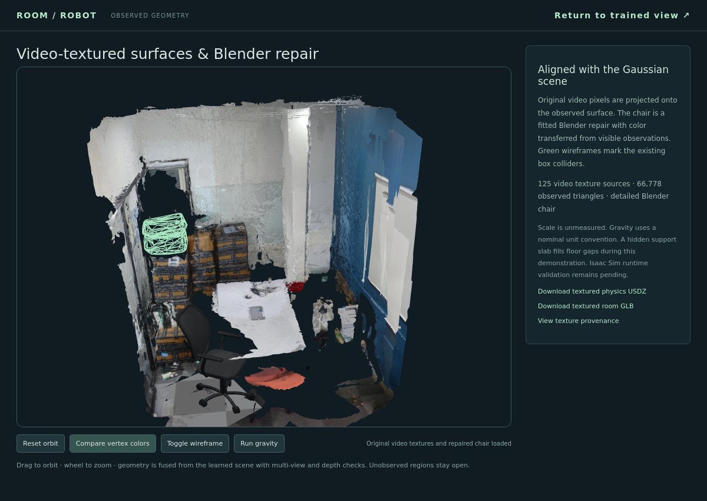

# Case study: a captured room with a repaired chair

The example comes from the original `room-to-robot` asset workspace. The goal is to show inspectable progress from a real capture: Gaussian appearance, incomplete observed geometry, video textures, and an authored chair repair. It is a historical reconstruction example, not evidence that the new portable pipeline has completed every adapter.

## Three artifacts, three useful views

| Inspector stage | Source in the original asset folder | Newly checked geometry |
| --- | --- | --- |
| Early surface | `outputs/da3_v2_final_geometry/observed_room.ply` | 36,386 vertices; 70,000 indexed triangles |
| Textured room | `outputs/realism/room-repaired.glb` | 129,060 triangles; 8 mesh primitives; 2 embedded images |
| Blender chair | `outputs/realism/chair-repaired.glb` | 62,280 triangles; 6 mesh primitives |

[Open the inspection page](mesh/index.html) through HTTP, or follow the [local/Pages instructions](PAGES.md). The early PLY is converted to a self-contained GLB for the page. Triangle indices and topology are preserved; positions/normals become float32, vertex colors are decoded from sRGB to linear glTF colors, and a root rotation converts source +Z-up to glTF +Y-up. The textured room and chair GLBs are copied byte-for-byte.

The chair GLB stores 186,840 position entries because primitives split geometry; this is not a claim of 186,840 unique welded geometric vertices. The inspector labels counts as stored vertices. It reports extents in scene units, not measured metres.

*This image is a supplied screenshot of the earlier viewer. The current inspector has a different interface. Neither image is a screenshot of a new browser QA run.*

## Historical training evidence

The saved [evaluation](mesh/evidence/gaussian-evaluation.json) reports 359,326 Gaussians at step 30,000, with 27.8386 dB PSNR and 0.9158 SSIM over 20 within-capture held-out views. The saved [status](mesh/evidence/historical-status.json) records 368 registered cameras, 348 training views, 125 depth-fusion views, and unmeasured scale. These values were read from existing receipts, not remeasured by retraining during this review.

The observed early surface contains 70,000 triangles. The retained static surface has 66,778 triangles after removing movable-object volumes. The later room GLB adds the authored 62,280-triangle chair and a small floor completion. Its total triangle count should not be compared as though all extra triangles represent newly observed room geometry.

The [texture audit](mesh/evidence/texture-audit.json) records calibrated projection from 125 original video views into a 4,951 × 4,947 atlas. It covers retained observed triangles; it does not establish full room coverage. The [chair fit](mesh/evidence/chair-pose-fit.json) reports mean silhouette IoU 0.653 over six views. The chair is an approximation with authored unseen geometry/materials.

The [historical asset validation](mesh/evidence/asset-validation.json) reports packed textures, Bullet drop checks, and USD structural checks. It explicitly marks metric measurement and Isaac runtime as false. These checks are historical and were not rerun in this session.

## What remains incomplete

Occluded surfaces, reflections, thin geometry, room coverage, measured scale, and physically correct materials remain unresolved. The historical run did not execute SAM 3D Objects, and the available receipts do not verify a live Astra repair call. The static inspection page performs no inference, rigid-body physics, or robot training.

The complete per-asset source paths, source hashes, output hashes, sizes, counts, conversion details, and mesh names are recorded in [assets.json](mesh/assets.json). `python3 tools/check_mesh_site.py` verifies the imported files against this inventory.

## Other local assets found

The broader search found 23 mesh files, 21 Gaussian PLYs, and 3 Blender scenes across the selected output/demo folders. Several are copies of the same artifacts, so these are file counts, not unique reconstructions. [Local asset inventory](local-asset-inventory.json) records their original workspace-relative paths, sizes, and mesh/splat classification. Per-part OBJ colliders, vendor code, and training data were excluded. The older office and pantry demo GLBs also contain meshes, while the desk PLY contains Gaussian attributes rather than faces.
