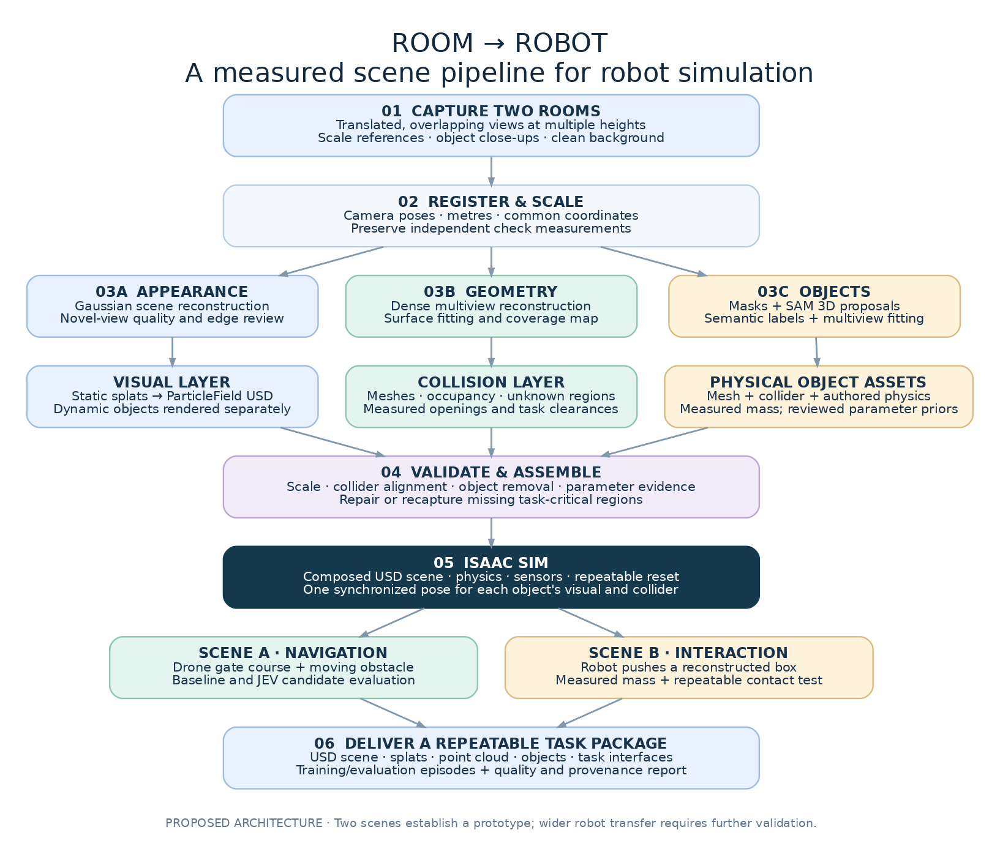

# Real2Sim workflow

Real2Sim separates three scene representations: Gaussian splats for appearance, meshes for surfaces, and independently placed objects for interaction. This separation allows visual reconstruction and geometric repair to be inspected independently.

The supplied architecture diagram is a project roadmap. Its measured geometry, physical assets, Isaac Sim tasks, and training interfaces describe the target system; they are not all implemented or verified in this repository.

## From capture to environment

| Stage | Current implementation | Output |
| --- | --- | --- |
| Capture | FFmpeg extracts frames from overlapping video views | Frame set and capture provenance |
| Camera recovery | Nerfstudio invokes COLMAP to recover camera poses | Registered cameras and coverage receipt |
| Appearance | Splatfacto optimizes the room, or an existing Gaussian PLY is imported | Gaussian scene with preserved appearance attributes |
| Geometry refinement | Configured Blender operations repair selected surfaces; splat crops remove selected regions | GLB repairs, Blender source, and operation receipts |
| Object reconstruction | Source images and masks drive the configured SAM 3D Objects adapter | Object Gaussian PLYs and inferred layout metadata |
| Assembly | Explicit transforms align splats, meshes, and selected objects | Portable browser package with checksums |
| Review | A separate Astra tool compares source frames with browser evidence and proposes typed edits | An isolated candidate for further visual review |

After the initial reconstruction, Astra reviews splat renders and source frames to propose targeted crops and Blender repairs. Explicitly movable repairs are registered as selectable objects with local box bounds; static structure remains in the repair layer. Reused packages preserve existing SAM objects and repairs. Astra does not run automatically as part of `run`. Repairs and object reconstruction are optional configuration stages. SAM 3D currently exports Gaussians rather than final triangle meshes; alignment, duplicate removal, and background completion require scene-specific review.

## Explore the supplied results

- [Office environment](mesh/environment/): walk through the textured room and edit the bottle/carton placements.
- [First-office mesh reference](mesh/analysis.html#office): inspect the room surface, chair, and early mesh.
- [Pantry](mesh/pantry/): the original guided tour and snack-pickup viewer.
- [Yellow room / booth](mesh/booth/): the original animated second-office GLB in a new player.
- [Mesh analysis](mesh/analysis.html): the later textured room, separate Blender chair, and early 70,000-triangle surface. These are distinct historical artifacts, with their provenance preserved.
- [Case-study evidence](CASE_STUDY.md): geometry counts, source paths, historical measurements, and limitations.

The refined office demonstration and the later mesh exports are separate versions. Screenshots of the earlier environment do not represent a new rendering of the later mesh. The [Pages guide](PAGES.md) covers hosting and local preview.

## Toward robot simulation

The remaining architecture requires measured scale, validated collision geometry, synchronized object transforms, physically checked parameters, and execution in the target simulator. Robot tasks additionally need repeatable resets, observation/action interfaces, and task-specific validation. The current browser viewer does not establish those capabilities.

See [pipeline execution](PIPELINE.md), [Astra review](REVIEW.md), and [validation status](VALIDATION.md) for reproducible commands and the checks performed.
